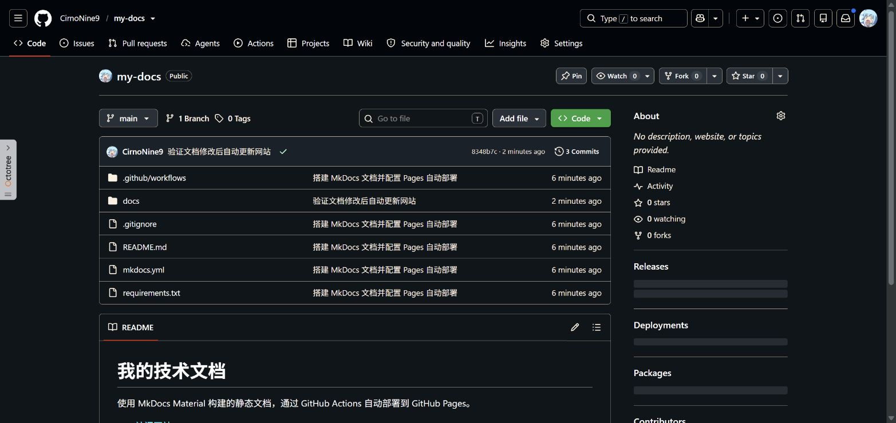
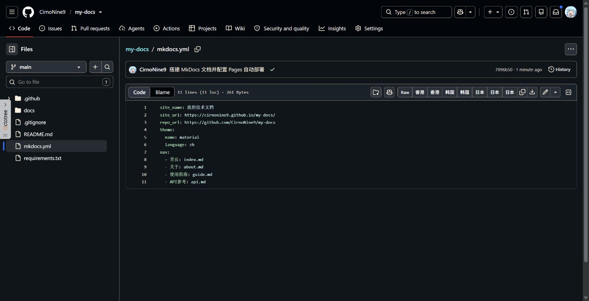
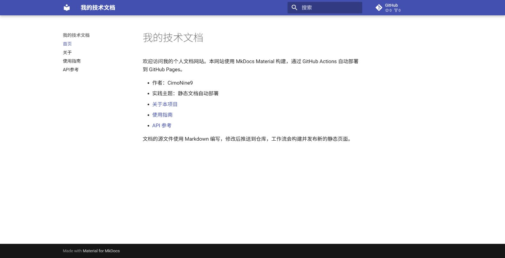
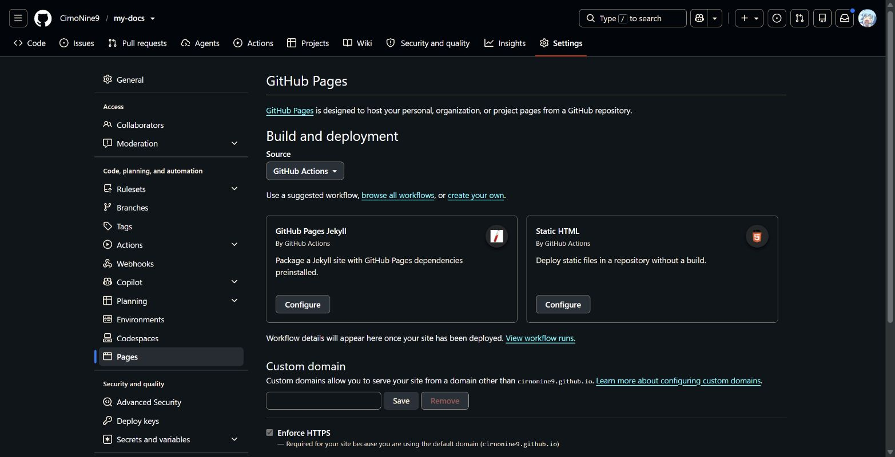
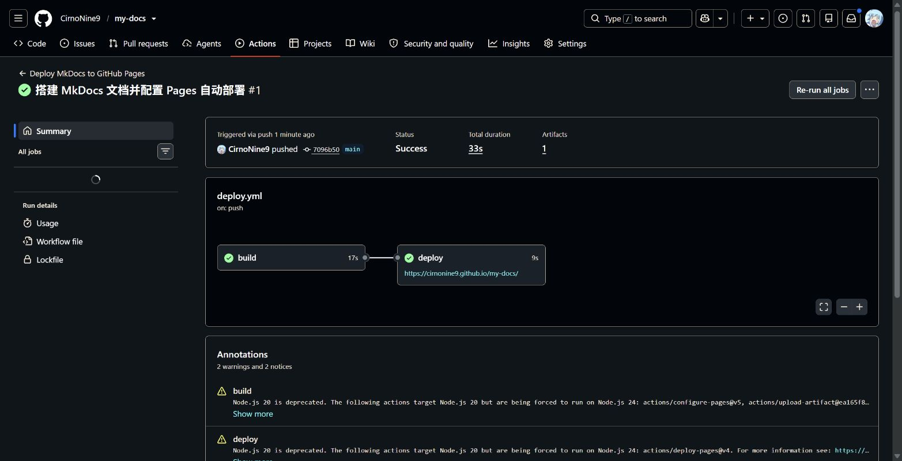
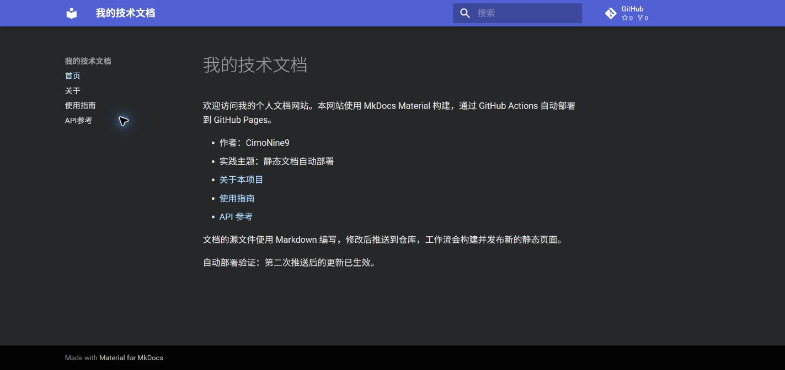
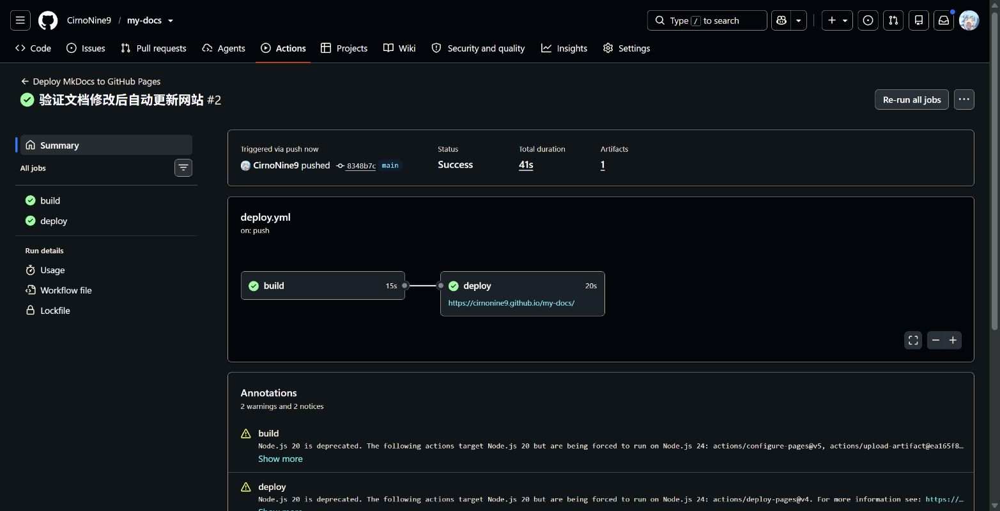

# 实践项目 2：个人实验报告

> 网站截图还需补充浏览器地址栏。

## 1. 基本信息

- GitHub 登录名：CirnoNine9
- 个人仓库：[CirnoNine9/my-docs](https://github.com/CirnoNine9/my-docs)
- 最终网站：[我的技术文档](https://cirnonine9.github.io/my-docs/)

## 2. 实践过程与关键截图

### 2.1 创建公开仓库

在个人账号下创建 `my-docs` 公开仓库，默认分支为 `main`。仓库公开后，教师可以查看源码、运行记录和报告。

### 2.2 项目结构与 MkDocs 配置

`docs/` 保存四个 Markdown 源文件；`mkdocs.yml` 中的 `nav` 组织网站导航，并指定 Material 主题。`site/` 是构建输出，已加入 `.gitignore`，不会作为源码提交。

### 2.3 本地构建和预览

使用 Python 3.12 虚拟环境安装 `requirements.txt` 中的依赖，运行 `python -m mkdocs build --strict` 成功构建，再启动本地预览，检查首页、导航和页面内容。

### 2.4 Pages 发布设置

在仓库 Pages 设置中将 Source 设为 GitHub Actions。工作流负责上传静态文件并部署，无需使用单独的发布分支。

### 2.5 首次构建与部署

把文档和工作流推送到 `main` 后，Actions 自动执行 `build` 和 `deploy`，两项均成功。[首次运行记录](https://github.com/CirnoNine9/my-docs/actions/runs/42365114557)。

### 2.6 网站访问和导航检查

打开[公开网站](https://cirnonine9.github.io/my-docs/)，逐一检查首页、关于、使用指南和 API 参考。关于页的表格、指南中的命令和 API 页的 JSON 示例正常显示，首页与其他页面之间的导航可用。

### 2.7 第二次推送与自动更新验证

修改首页并推送后，工作流由 `push` 自动触发，未手动启动部署。构建与部署成功后刷新网站，可见“自动部署验证：第二次推送后的更新已生效。”

- [第二次推送的提交](https://github.com/CirnoNine9/my-docs/commit/8348b7c2717edf876816576a1b47745be0a33fab)
- [第二次自动运行记录](https://github.com/CirnoNine9/my-docs/actions/runs/42365409519)

## 3. 问题与处理

首次通过 `uv` 安装 Python 3.12 时，命令报告版本链接目录问题，但安装目录中的解释器可被识别。随后使用该解释器成功创建虚拟环境并完成本地构建。项目移动到新的工作目录后，重新创建虚拟环境并安装依赖，以适配新路径。

第二次部署成功后，第一次打开网页仍显示旧内容；刷新后出现新文字，确认更新已经生效。两次 Actions 均成功，但日志提示部分官方 Pages Actions 原本面向 Node.js 20，运行器已将其切换到 Node.js 24；另有 `ubuntu-latest` 迁移提示。当前作业指定工作流能成功运行，因此保留原配置并记录提示。

## 4. 原理理解

1. `docs/` 保存手工维护的 Markdown 源文档；`site/` 保存构建生成的 HTML、样式和其他静态文件。重新构建时会清理并生成 `site/`，因此应修改源文件，而不是手工修改生成目录。
2. `main` 分支收到涉及 `docs/**`、`mkdocs.yml`、`requirements.txt` 或工作流文件的推送时自动运行；也可以通过 `workflow_dispatch` 手动运行。
3. `build` 检出源码、配置 Python、安装依赖、构建并上传 `site/`；`deploy` 依赖成功的 `build`，将上传的产物发布到 GitHub Pages。
4. 只修改 `report/README.md` 不会触发自动部署，因为它不在 `push.paths` 列表中。
5. 本次通过官方 Pages Actions 上传构建产物并部署，发布内容由 Pages 服务接收，不需要将生成文件推送到 `gh-pages` 分支。

## 5. 实践体会

这次实践让我把文档源码、构建产物和部署后的网站区分开来。推送后查看 Actions 的任务状态，再打开网站确认变化，比只检查一次构建成功更能发现发布或缓存问题。
